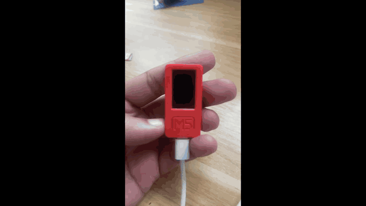
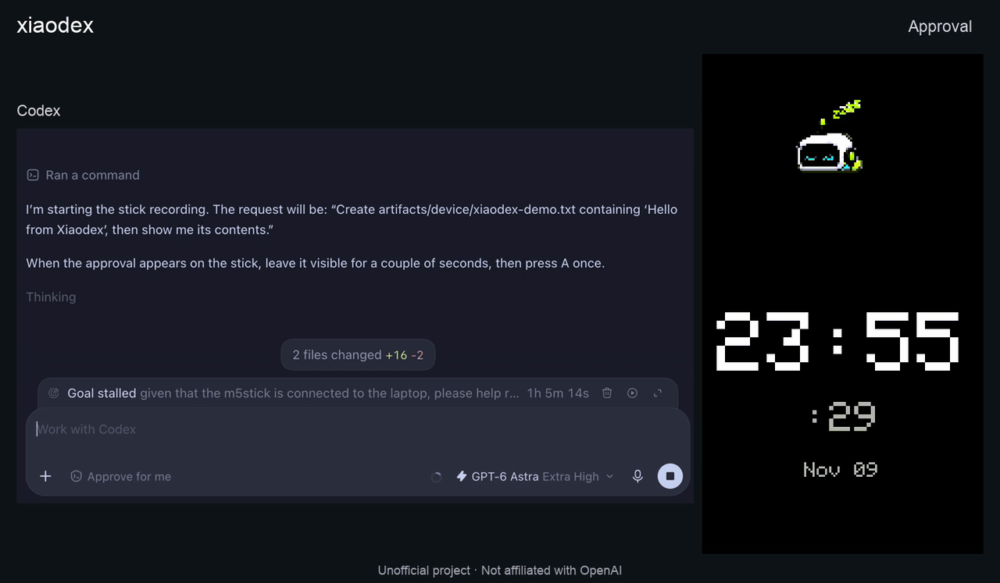
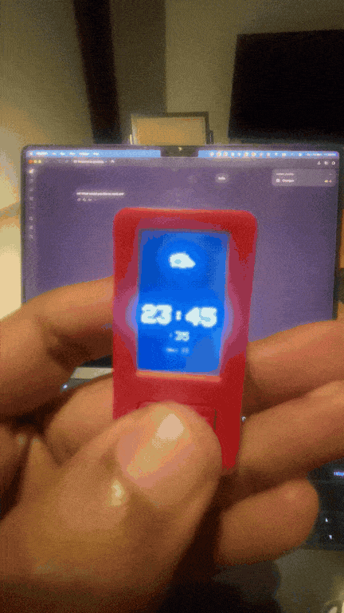
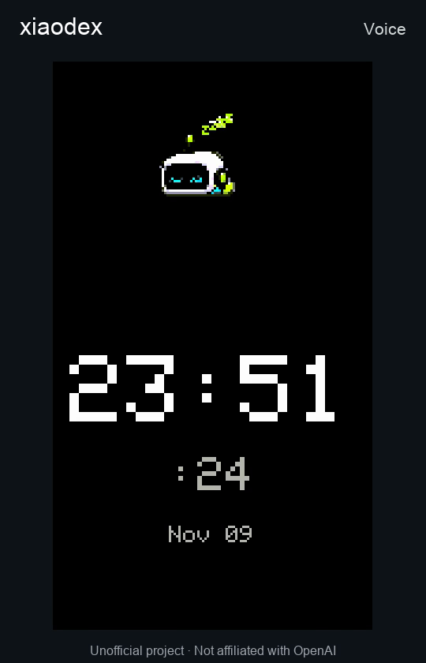
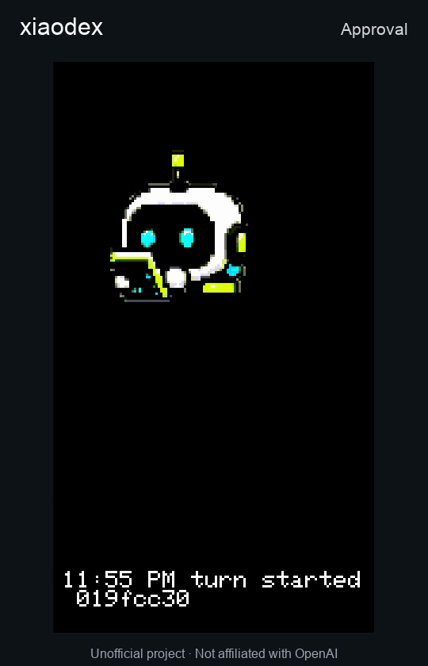
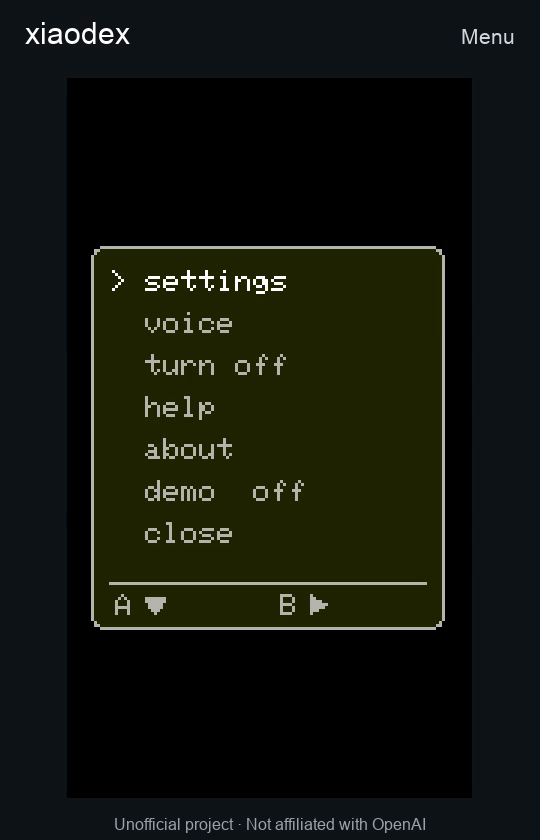
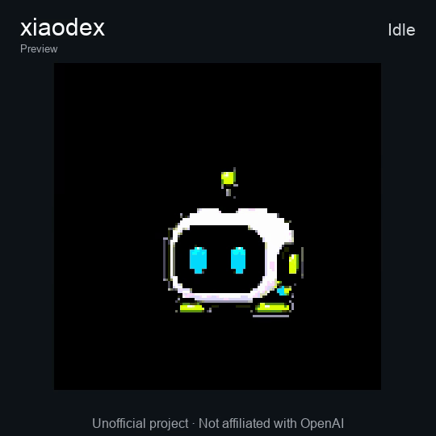
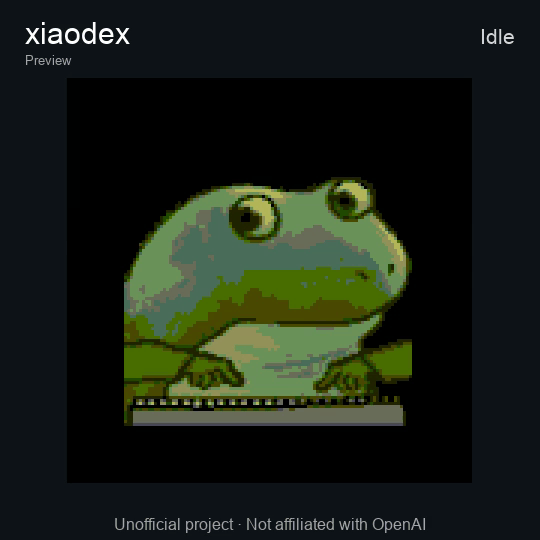
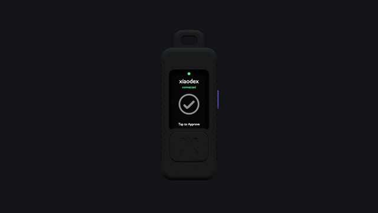

# Xiaodex

Xiaodex is a handheld companion for the Codex Mac app, built around an
M5StickC Plus. Hold A to speak to Codex, read its reply on the screen, and
approve or deny requests from the device.

This is an unofficial, independent project. It is not affiliated with,
endorsed by, or sponsored by OpenAI.



[Watch on YouTube](https://youtu.be/vtng2e82-aY).



The stick connects over Wi-Fi to a Node.js bridge on your Mac. The bridge
sends audio to OpenAI Realtime for transcription, then submits the text to
the Mac app's existing Codex chat. Keep Codex and the bridge running.

## Origins and credits

The firmware started from Anthropic's
[Claude Desktop Buddy](https://github.com/anthropics/claude-desktop-buddy),
including its pet states, GIF packs, BLE transport and A/B approval controls.
Its [MIT license](firmware/m5stickc-plus/CLAUDE_DESKTOP_BUDDY_LICENSE) remains
in the repo.

Steve Ruiz's M5 Stick S3 prototype inspired the voice workflow
([demo](https://x.com/steveruizok/status/2044520936540438932),
[implementation](https://x.com/steveruizok/status/2044875679779451281)).
Xiaodex uses no code from that prototype.

See [NOTICE.md](NOTICE.md) for M5Stack and Doom notices, and the
[Bufo credits](firmware/m5stickc-plus/characters/bufo/README.md) for its artwork.

## What you need

- An original 4 MB M5StickC Plus, a USB data cable, and a Mac.
- Codex Desktop running with an existing chat.
- Node.js 22.13 or newer, Python 3, and PlatformIO Core (`pio`).
- Wi-Fi that lets the stick reach your Mac, with TCP and UDP port 8787 allowed.
- An OpenAI API key for voice transcription.

The USB tools expect a macOS `/dev/cu.usbserial-*` port.

## Set up the Mac

```bash
git clone https://github.com/goodhamgupta/xiaodex.git
cd xiaodex
npm ci
npm run configure:bridge-token

python3 -m venv /tmp/xiaodex-tools
/tmp/xiaodex-tools/bin/python -m pip install \
  -r firmware/m5stickc-plus/tools/requirements.txt
```

The token command creates a gitignored `.env`. For voice, add your API key
without removing the generated `CODEX_BUDDY_TOKEN` line:

```dotenv
OPENAI_API_KEY=your-openai-api-key
```

The API key stays on the Mac. The firmware build reads only the shared bridge
token from `.env`, so generate it before flashing.

## Flash the M5StickC Plus

Connect the stick over USB and find its port:

```bash
pio device list
```

Use your device's port below. Flash both the firmware and pet sprites:

```bash
DEVICE_PORT=/dev/cu.usbserial-XXXXXXXX
pio run --project-dir firmware/m5stickc-plus -t upload --upload-port "$DEVICE_PORT"
pio run --project-dir firmware/m5stickc-plus -t uploadfs --upload-port "$DEVICE_PORT"
```

Start the bridge in another terminal from the repository root:

```bash
node --env-file=.env ./bin/codex-buddy.js --host 0.0.0.0 --port 8787 \
  --desktop-session-log latest
```

Use one of the bridge's printed LAN addresses in place of `192.168.1.10`.
Back in the USB terminal, configure Wi-Fi; the tool prompts for the password:

```bash
set -a
. ./.env
set +a
/tmp/xiaodex-tools/bin/python firmware/m5stickc-plus/tools/configure_wifi.py \
  --port "$DEVICE_PORT" --ssid "your-wifi" --host 192.168.1.10
```

Wi-Fi settings survive a reboot. After provisioning, the stick can run on
battery while the Mac bridge stays running.

If the Mac's address changes, update the bridge endpoint without replacing
the saved Wi-Fi settings:

```bash
/tmp/xiaodex-tools/bin/python firmware/m5stickc-plus/tools/configure_wifi.py \
  --port "$DEVICE_PORT" --bridge-only --host 192.168.1.20
```

To erase the saved Wi-Fi and bridge settings:

```bash
/tmp/xiaodex-tools/bin/python firmware/m5stickc-plus/tools/configure_wifi.py \
  --port "$DEVICE_PORT" --forget
```

Changing the shared token requires updating `.env` and reflashing, because
the compiled token takes precedence over the saved device token. See the
[troubleshooting guide](docs/m5stickc-plus-flash-debug.md) for USB, flashing,
and connection problems.

## Voice input

Hold the large front button, A, for about 200 ms. Keep holding while speaking,
then release to send. Recording stops after 30 seconds. The screen shows the
transcript, then streams Codex's response.





By default, each recording goes to the Codex chat with the most recent user
activity across projects. The bridge keeps that chat selected for the whole
turn. Add `--voice-thread-id TASK_UUID` to the bridge command to pin it to one
chat. Approval prompts take priority over recording.

The bridge watches new Desktop chats across projects by default, so their
first approval can reach the stick without a voice turn or manual pinning.
`--desktop-session-log latest` makes that default explicit; pass a log path to
watch one chat instead. See the [bridge reference](docs/bridge.md).

## Controls

| Action | Control |
| --- | --- |
| Approve a pending request once | Tap A |
| Deny a pending request | Tap B |
| Speak to Codex | Hold A, speak, release |
| Cycle Home, Pet, and Info | Tap A when no prompt is open |
| Scroll activity or change the current page | Tap B |
| Open the menu | Hold B |
| Toggle the display / shut down | Tap / hold the separate power button |

If the screen is asleep, press A or B to wake it, then press again to act.
Use Settings to change pets, sound and Wi-Fi.

The approval flow from the stick's view:



Settings, pet selection and stats:



## Pets

Choose an installed pet under Settings → sprite pack. FED tracks output tokens
toward the next level; ENERGY is virtual stamina. MOOD reflects approval speed
and frequent denials. Battery charge appears under Info → Device.

These clips preview the seven animation states: idle, busy, attention,
celebrate, heart, dizzy and sleep.





The [device guide](docs/device-guide.md) explains pet stats, naps and settings.
The [asset guide](docs/assets.md) covers importing and flashing custom packs.

## Print the case

I used GPT-5.6 (Sol) in Codex to write the Blender Python for the casing:

1. Supply the product sheet and official M5StickC Plus reference mesh,
   measuring 24 × 48 × 13.5 mm.
2. Generate two shells, button caps and openings for the screen, ports and
   lanyard with Blender's `bpy`/`bmesh` APIs. Allow 0.30 mm clearance per side.
3. Inspect renders and an exploded view. Check clearances, button travel and
   watertight meshes, then use measurements and screenshots to revise the code.
4. Export STLs and test a print on the stick.

We went through three design iterations. The latest printed case has fit
issues: the Blender model and printed parts don't match the real M5StickC
Plus as intended. I suspect a mix of GPT-5.6 (Sol)'s limits on dimensional
accuracy and the printer settings, but I haven't isolated the cause.

| Blender render | Printed case |
| --- | --- |
|  |  |

This render shows an earlier revision with a mock screen UI. Use the
[print guide](cad/m5stickc-plus-xiaodex/PRINTING.md) for current dimensions
and assembly. The grille backer is a thin mesh/film insert.

The [CAD folder](cad/m5stickc-plus-xiaodex/README.md) contains the STLs, Blender
scene, generator, renders, and [CAD video](cad/m5stickc-plus-xiaodex/xiaodex_demo.mp4).
Open the included Blender scene before running the generator so it can copy
the embedded M5 reference mesh.

## Doom

The separate [Doom firmware](firmware/m5stickc-plus-doom/README.md) uses tilt
for movement, A to fire, and B for use/menu. It requires a firmware swap;
the guide includes steps to restore Xiaodex.


## Development and docs

```bash
npm test
node ./bin/codex-buddy.js --help
```

To try the bridge without hardware, start it on loopback:

```bash
node ./bin/codex-buddy.js --host 127.0.0.1 --port 8787
```

Then run `npm run simulate-device` in another terminal. Press `a` to approve
or `d` to deny a request in the simulator.

The CLI, package, protocol, and `CODEX_BUDDY_*` environment names retain their
existing names for compatibility.

| Reference | Contents |
| --- | --- |
| [Device guide](docs/device-guide.md) | Controls, screens, voice, pet stats, and settings |
| [Bridge reference](docs/bridge.md) | Desktop connection, task targeting, and approval handling |
| [Protocol](docs/protocol.md) | Device messages, audio transport, and response streaming |
| [Troubleshooting](docs/m5stickc-plus-flash-debug.md) | USB, flashing, networking, and screen captures |
| [Pet assets](docs/assets.md) | Sprite sources and character-pack tools |
| [Hardware](docs/hardware.md) | Board details and case requirements |
