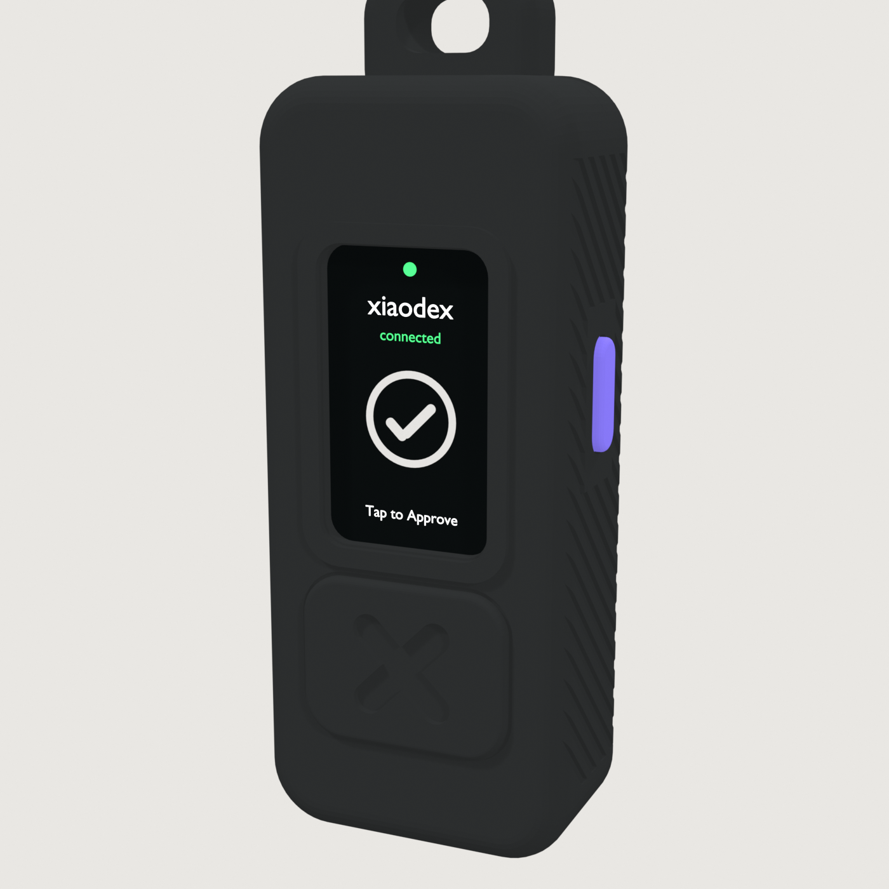
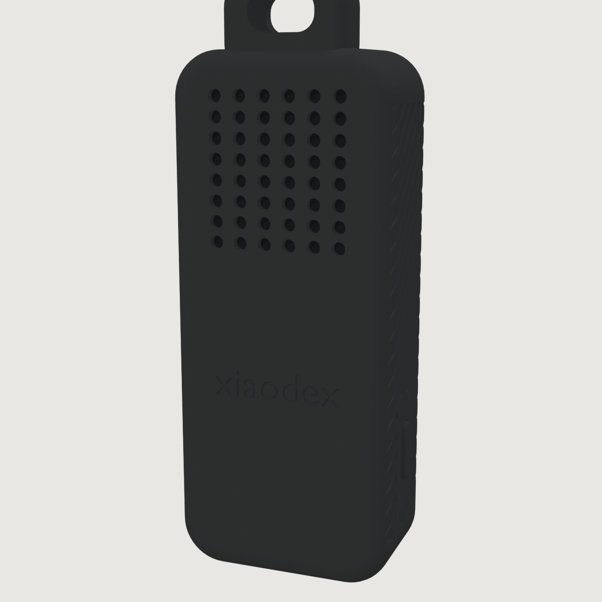
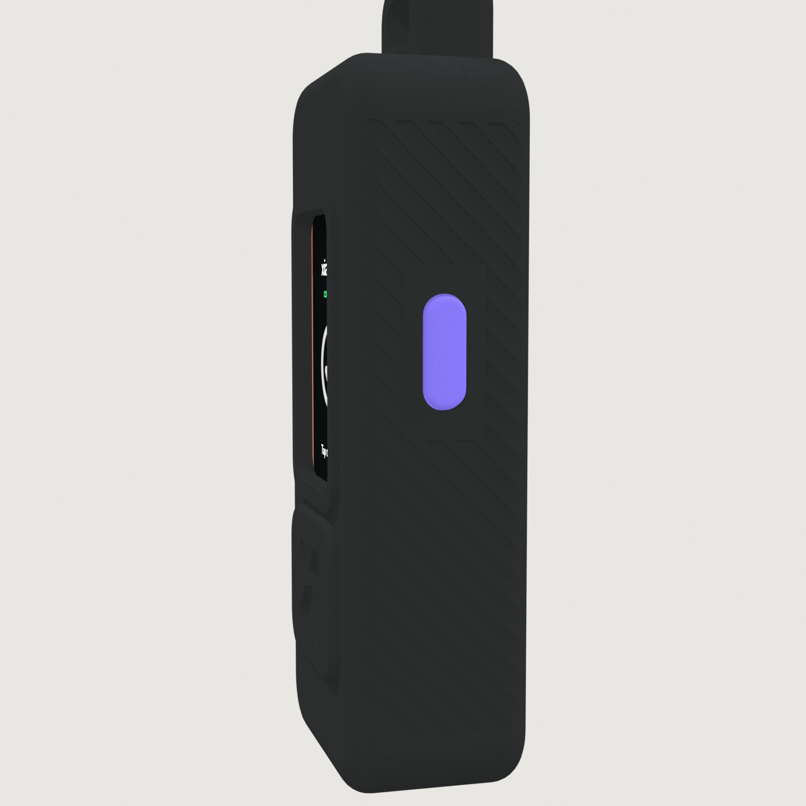
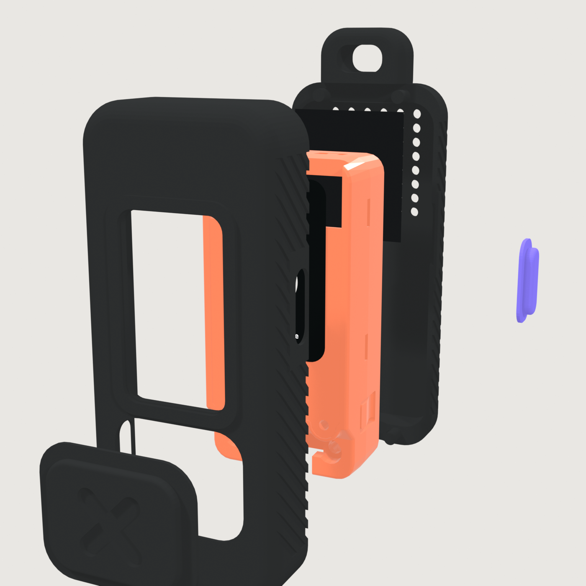

# Xiaodex Companion Case (M5StickC Plus)

A 3D-printable enclosure that turns a legacy M5StickC Plus into the **xiaodex**
companion device: approve requests, send voice commands, and stay in control —
as drawn on the xiaodex product sheet.

**Launch demo:** [`xiaodex_demo.mp4`](xiaodex_demo.mp4) — 41 s studio film
(hero push-in, full orbit, button actuation at true travel, exploded assembly,
dimensioned spec card), rendered from this CAD in Blender.

## Design intent (from the product sheet)

- Charcoal two-shell body with an integrated lanyard loop
- Live screen window showing the xiaodex UI (status dot / `connected` /
  approve ring / *Tap to Approve*)
- Large **X**-embossed approve button below the screen (drives the M5's
  front Button A)
- Purple side button on the right flank (drives the M5's Button B — matches the official device layout)
- Low-profile power cap on the left flank
- Perforated speaker/mic grid and debossed `xiaodex` wordmark on the back
- USB-C opening in the bottom face
- Diagonal grip ribs on both narrow flanks

## Nominal dimensions

| Item | Value |
| --- | --- |
| Overall (incl. lanyard loop) | **27.0 × 16.0 × 72.0 mm** |
| Body (excl. loop) | 27.0 × 16.0 × 63.0 mm |
| Raised screen bezel / approve button | up to 0.85 mm proud of the 16.0 mm body |
| M5 reference envelope (pinned official STL) | 24.00 × 48.00 × 13.50 mm |
| Device clearance | 0.30 mm per side |
| Screen window | 14.2 × 24.2 mm, centred +8.0 mm from device centre |
| Official shell display opening | 14.8 × 24.8 mm (ray-measured from the pinned STL); window = opening − 0.3 mm cover margin per side so the bezel always hides the orange shell ring |
| Approve button (X cap) | 18.0 × 14.0 mm plate, Button A centre −13.8 mm, 0.35 mm travel |
| Side button B (purple) | right flank, +8.25 mm from device centre |
| Power cap | left flank, −14.5 mm from device centre |
| USB-C slot | 11.0 × 5.5 mm through the bottom wall |
| Speaker/mic grid | 6 × 8 holes, Ø1.6 mm |
| Lanyard loop slot | 8.0 × 4.5 mm |

The M5 feature map (button centres, travel) reuses validated measurements
from earlier enclosure work; those values are defined directly in
`generate_xiaodex.py`. The device reference is the official M5Stack
[`StickC-Plus.stl` at commit `48baa75a9476f4070dd5f107c1c28e2c9f383a96`](https://github.com/m5stack/M5_Hardware/blob/48baa75a9476f4070dd5f107c1c28e2c9f383a96/Products/K016-P_StickC-Plus/Structures/StickC-Plus.stl),
embedded in `xiaodex_case_blender_validation.blend`. Its copyright and MIT
license are preserved in [M5STACK_REFERENCE_LICENSE.txt](M5STACK_REFERENCE_LICENSE.txt).
The screen window is sized from the official shell's display through-
opening (14.8 × 24.8 mm, measured by ray-casting the pinned STL) rather than
the older 19.0 × 28.8 access keepout, which exposed ~2 mm of the M5's orange
shell around the glass on printed units. The 1.14" ST7789v2 panel has a
14.864 × 24.912 mm active area in a 17.6 × 31.0 mm glass.

## Parts

| File | Part | Notes |
| --- | --- | --- |
| `blender-stl/xiaodex_front_tray.stl` | Front tray | Screen window with raised bezel, X-button aperture + flange pocket, USB slot, peg sockets |
| `blender-stl/xiaodex_rear_cover.stl` | Rear cover | Speaker grid, debossed wordmark, lanyard loop, 4 alignment pegs |
| `blender-stl/xiaodex_button_x.stl` | Approve button | Debossed X, retained by an internal flange, presses M5 Button A |
| `blender-stl/xiaodex_button_b.stl` | Side button B | Right flank; print in purple filament |
| `blender-stl/xiaodex_power_cap.stl` | Power cap | Left flank; low-profile, charcoal |
| `blender-stl/xiaodex_grille_mesh.stl` | Grille backer | 0.14 mm dark mesh/film insert behind the grid (cut from adhesive mesh; not FDM-printable) |
| `xiaodex_case_blender_validation.blend` | Inspection scene | Millimetre scene: shells, caps, screen demo UI, pinned M5 reference, camera + studio lights |
| `generate_xiaodex.py` | Parametric generator | Runs with `xiaodex_case_blender_validation.blend` loaded (it copies the pinned M5 reference from the separate reference scene) |

All six part meshes export watertight (0 non-manifold edges).

## Renders

| | |
| --- | --- |
|  |  |

## Printing

See **[PRINTING.md](PRINTING.md)** for the verified print manifest, settings
and assembly order.

- Charcoal PETG or ASA for tray, cover and X button; purple for button B.
- Print shells front-face-down / back-face-down; no supports needed except a
  small overhang under the loop's front half (bridges 2.5 mm).
- The rear cover locates on four Ø2.2 mm pegs (Ø2.5 mm sockets); run
  0.10–0.30 mm gap trials before relying on the friction fit.

## Status

I've printed this casing and will add photos of the physical build.
The Blender checks cover clearances, button travel and aperture positions.
For your own print, check button return, peg fit and lanyard strength using
the print guide.
